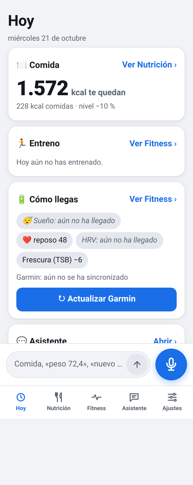
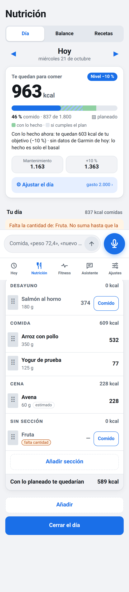
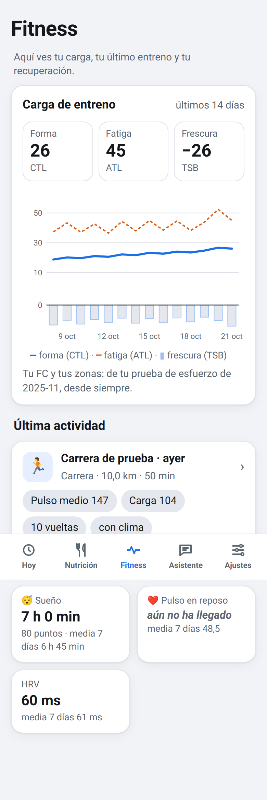
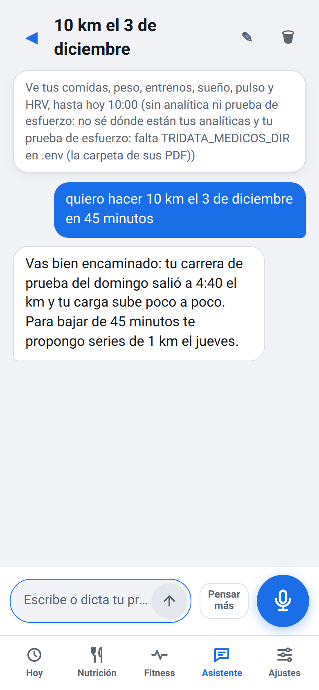

<p align="center">
  
</p>

<h1 align="center">TriData</h1>

<p align="center">
  <b>Tu entrenamiento, tu comida y tu recuperación en un solo sitio, con un equipo de IA que lo ve todo a la vez.</b><br>
  Datos de Garmin · kcal del día · carga de entrenamiento · coach, nutricionista y fisio en tu PC · app en el móvil.<br>
  <sub>Local, privado y sin cuotas: todo vive en tu ordenador.</sub>
</p>

<p align="center">
  
  
  
  
</p>
<p align="center"><sub>Capturas de las pruebas automáticas, con datos inventados.</sub></p>

---

## Qué es

Tu reloj sabe cómo entrenas. Tu app de comida sabe lo que comes. Tu analítica está en un cajón.
**Ninguno ve el cuadro completo**, y por eso los consejos que recibes son genéricos.

TriData lo junta todo en tu ordenador y le pone encima un **equipo**: entrenador, nutricionista y
fisio. El equipo lee tus entrenos, tus comidas, tu sueño y tus análisis **a la vez**, y razona
contigo con tus números de verdad.

> «Quiero bajar de 45 minutos en un 10K el 3 de diciembre, pero esta semana he dormido mal y estoy en déficit.»
>
> Con TriData ese plan se negocia, no se recibe.

Son tres piezas que trabajan juntas:

| Pieza | Dónde vive | Qué hace |
|---|---|---|
| 🖥️ **La app** | En tu PC | Se trae cada día tus datos de Garmin, guarda lo que comes y calcula tu carga y tus kcal. |
| 📱 **El móvil** | En tu pantalla de inicio | La misma app, instalada como una más. Apuntas la comida y miras cómo vas desde cualquier sitio. |
| 🤖 **El equipo** | Claude Code, en tu PC | Coach, nutricionista y fisio. Ven todo tu contexto, te proponen y cambian cosas **solo cuando dices «sí»**. Le hablas también desde el móvil. |

## Puntos fuertes

- **Todo tu contexto, de una vez.** Entrenos con vueltas y clima, carga (CTL / ATL / TSB), zonas
  de pulso, sueño, VFC, pulso en reposo, comidas, peso, analíticas y prueba de esfuerzo. Nada de
  copiar y pegar entre apps.
- **Cuenta calorías de verdad.** Tu presupuesto del día sale de tu gasto basal, tus pasos de
  Garmin y el déficit que elijas. Apuntas por secciones, con recetas con versiones, tara de la olla
  y más de 80 alimentos comunes ya cargados. El balance y el peso se ven entre las fechas que quieras.
- **Analiza tu entrenamiento.** Forma, fatiga y frescura con la fórmula a la vista. Tus semanas
  apiladas por deporte en horas, km, carga o zonas, filtrables por natación, bici o carrera. Cada
  sesión con sus vueltas, su ritmo y su pulso.
- **Un equipo que actúa, no solo opina.** Apunta comida, peso, cafés y suplementos. Cambia el plan,
  importa un plan en Markdown, lee el PDF de tu última analítica y prepara una carrera sobre el
  perfil real del recorrido. Siempre te enseña antes lo que va a guardar y espera tu «sí».
- **Plan, reloj y calendario.** Lleva tu plan semana a semana, manda las sesiones a tu reloj
  Garmin y las pone en tu Google Calendar.
- **Privado de verdad.** Un único fichero SQLite en tu PC, con copia verificada antes de cada
  sincronización. Sin nube nuestra, sin cuenta y sin telemetría. Tus datos de salud nunca llegan a
  este repositorio.
- **Sin cuotas.** La app no llama a ninguna IA de pago ni necesita clave de API. El equipo usa tu
  propia suscripción de Claude.

## ¿Es para mí?

Sí, si tienes un **reloj Garmin**, entrenas en serio (triatlón, carrera, bici o natación) y quieres
que alguien mire **todo** junto contigo.

> ⚠️ **Siendo sinceros:** hoy instalarlo pide algo de soltura con la terminal. Hay que clonar un
> repositorio, rellenar un fichero de configuración y dejar dos servicios en marcha. Si alguna vez
> has instalado un programa con `pip`, puedes hacerlo: calcula **una tarde tranquila**. Está
> probado en **Linux**. En macOS debería funcionar con pequeños cambios (los servicios), y en
> Windows, con WSL.

Necesitas:

- Un **PC que esté encendido** cuando quieras usar la app (es el servidor).
- **Python 3.10 o superior** y `git`.
- Tu cuenta de **Garmin Connect**.
- **Tailscale** (gratis), para ver la app en el móvil fuera de casa.
- Una suscripción de **Claude** con **Claude Code**, para el equipo.
- Opcional: una cuenta de **Google**, para el calendario.

## Instalación paso a paso

### 1. Bajar e instalar

```bash
git clone https://github.com/andres-bejarano/tridata.git
cd tridata
python3 -m venv .venv && source .venv/bin/activate
pip install -e ".[app]"   # la app
pip install -e ".[mcp]"   # el servidor MCP del equipo
```

### 2. Configurar Garmin y tus datos

```bash
cp .env.example .env
```

Abre `.env` y rellena lo que pide. `.env` no se sube nunca a git.

- `GARMIN_EMAIL` y `GARMIN_PASSWORD`: tu cuenta de Garmin Connect. Solo se usan para hablar con Garmin.
- `TRIDATA_HR_MAX` y `TRIDATA_HR_REST`: tu pulso máximo y en reposo. Con ellos se calcula la carga.
- `TRIDATA_BASAL_KCAL` y `TRIDATA_KCAL_POR_PASO`: tu gasto basal y las kcal por paso. Solo se leen
  el primer día; después se cambian en **Ajustes**.
- Opcional, `TRIDATA_MEDICOS_DIR`: la carpeta con los PDF de tus analíticas. Se leen ahí y nunca se copian.

### 3. Traer tu historia de Garmin

```bash
tridata sync --since 2026-01-01
```

Pon la fecha desde la que quieras datos. La primera vez tarda: Garmin limita las peticiones y
TriData espera cuando hace falta.

### 4. Arrancar la app

```bash
tridata web
```

Abre <http://127.0.0.1:8765> en el navegador del PC. Ya funciona.

Para que arranque sola con el PC, crea `~/.config/systemd/user/tridata-web.service` (cambia las dos rutas por las tuyas):

```ini
[Unit]
Description=TriData web
After=network-online.target

[Service]
WorkingDirectory=/ruta/a/tridata
ExecStart=/ruta/a/tridata/.venv/bin/tridata web
Restart=on-failure
RestartSec=10

[Install]
WantedBy=default.target
```

```bash
systemctl --user daemon-reload && systemctl --user enable --now tridata-web.service
```

### 5. Sincronizar cada día, sin acordarte

`daily_update.sh` hace una copia de seguridad, trae lo nuevo de Garmin (vueltas y clima
incluidos) y deja las exportaciones al día. Un temporizador lo lanza cada hora de 08:00 a 14:00
hasta que sale bien, y también al encender el PC si estaba apagado.

```bash
cp .config/systemd/user/tridata-sync.* ~/.config/systemd/user/
# Edita tridata-sync.service: ExecStart debe apuntar a TU daily_update.sh
systemctl --user daemon-reload && systemctl --user enable --now tridata-sync.timer
```

### 6. La app en tu móvil

La app la sirve tu PC. Para verla desde el móvil, también fuera de casa, sin abrir puertos ni
exponerla a internet, usa **Tailscale**: una red privada entre tus dispositivos.

1. Instala Tailscale en el PC (<https://tailscale.com/download>) y entra con tu cuenta.
2. En el PC, publica la app **solo dentro de tu red de Tailscale**:
   ```bash
   sudo tailscale serve --bg 8765
   ```
   Te dará una dirección del tipo `https://tu-pc.tu-red.ts.net`.
3. Instala la app de **Tailscale** en el móvil y entra con **la misma cuenta**.
4. Abre esa dirección en el móvil y añádela a la pantalla de inicio:

| 📱 iPhone | 🤖 Android |
|---|---|
| Ábrela en **Safari** (en iPhone tiene que ser Safari). | Ábrela en **Chrome**. |
| Toca **Compartir** (el cuadrado con la flecha hacia arriba). | Toca el menú **⋮** de arriba a la derecha. |
| Baja y elige **Añadir a pantalla de inicio**. | Elige **Instalar aplicación** (o **Añadir a pantalla de inicio**). |
| Toca **Añadir**. | Confirma con **Instalar**. |

Aparece el icono de TriData. Se abre a pantalla completa, como una app más.

> Si cambia el icono y en el móvil sigue saliendo el viejo, borra el acceso directo y vuelve a añadirlo.

### 7. Tu equipo: coach, nutricionista y fisio

El equipo es **Claude Code** hablando con TriData por su **servidor MCP**, que viene instalado
desde el paso 1.

1. Instala Claude Code (<https://claude.com/claude-code>) y entra con tu cuenta de Claude.
2. Conéctale TriData para todas tus carpetas:
   ```bash
   claude mcp add --scope user tridata -- /ruta/a/tridata/.venv/bin/tridata-mcp
   ```
3. Crea una carpeta para tu equipo, por ejemplo `~/coach`, con un `AGENTS.md` que diga quién eres
   y cómo quieres que te hable. Una base para empezar:
   ```markdown
   # Mi equipo: entrenador, nutricionista y fisio

   Aquí no se programa: eres mi equipo. Responde como 🏃 Entrenador, 🥗 Nutricionista o
   🩺 Fisio según lo que pregunte, con mis números de TriData (empieza por `get_contexto`).
   Antes de juzgar una sesión, abre sus vueltas. Para cambiar algo, enséñame lo que vas a
   guardar y espera mi «sí». Respuestas cortas: te escribo desde el móvil.

   Sobre mí: objetivo, próxima carrera, molestias…
   ```
   Añade también `CLAUDE.md` con una sola línea, `@AGENTS.md`.
4. Ábrelo: `cd ~/coach && claude`. Prueba: *«¿cómo voy esta semana?»*.
5. **Desde el móvil:** activa **Remote Control** en esa sesión de Claude Code (mira la
   documentación de Claude Code) y háblale desde la app de Claude.

Herramientas del equipo:

- **Solo leen:** `get_contexto`, `list_activities`, `get_activity`, `get_daily_metrics`,
  `get_training_load`, `get_weekly_summary`, `get_records`, `get_recetas`, `get_rutas`,
  `get_perfil_ruta`, `get_analiticas_pendientes`, `preparar_cambio`, `preparar_plan` y
  `preparar_transcripcion`.
- **Escriben, siempre tras tu «sí»:** `hacer_cambio`, `apuntar_comida`, `apuntar_peso`,
  `apuntar_toma`, `apuntar_leche_cafes`, `importar_plan` y `guardar_transcripcion`.

Cada cambio deja una nota en **Ajustes › Lo que ha hecho el coach**.

### 8. Opcional: Google Calendar

Para que tus sesiones aparezcan en tu calendario:

1. En <https://console.cloud.google.com>, crea un proyecto y activa la **Google Calendar API**.
2. En la pantalla de consentimiento OAuth, déjala en modo **Prueba** y añade tu Gmail como
   **usuario de prueba**.
3. Crea unas credenciales **OAuth de tipo «App de escritorio»** y descarga el JSON **fuera** del repositorio.
4. En `.env`, apunta `TRIDATA_GOOGLE_CLIENTE=/ruta/al/client.json` y conecta desde **Ajustes › Google Calendar**.
   El permiso se guarda en `~/.tridata/google-token.json`.

> En modo **Prueba**, Google caduca el permiso cada **7 días**: cuando pase, vuelve a conectar
> desde Ajustes. Solo pide permiso sobre los calendarios que crea la propia app.

## Qué hay en la app

| Pantalla | Qué ves |
|---|---|
| **Hoy** | De un vistazo: kcal que te quedan, el entreno del día y cómo llegas (sueño, VFC, pulso en reposo, frescura). |
| **Nutrición** | El día por secciones, el balance y el peso entre dos fechas, tus recetas y la suplementación. |
| **Fitness** | Forma, fatiga y frescura con su fórmula; tus semanas por deporte (horas, km, carga, zonas); la última sesión con vueltas y clima; tu plan. |
| **Ajustes** | Gasto basal, kcal por paso, déficit, pulso y zonas (con su origen), carreras, Google Calendar y lo que ha hecho el coach. |

La carga es **TRIMP de Banister calculado con el pulso** (con tu máximo y tu reposo), no el TSS
de potencia. CTL y ATL son medias exponenciales de 42 y 7 días.

## Privacidad

- Todo vive en `~/.tridata/data.sqlite3`, en tu PC, con copia verificada en `~/.tridata/backups/`
  antes de cada sincronización.
- La app no llama a ninguna IA. Lo que preguntas al equipo pasa por **tu** sesión de Claude Code.
  Ese proveedor recibe lo que el equipo lee para contestarte.
- Con Tailscale, la app solo se ve desde tus dispositivos: nada queda abierto a internet.
- `tridata comprobar-privados` revisa el código, el historial de git y los logs buscando los
  valores de tus analíticas. Solo imprime cuántas veces aparecen, nunca los valores.

## Comandos

| Comando | Hace |
|---|---|
| `tridata web` | Arranca la app (`--host` y `--port` para cambiar dónde escucha). |
| `tridata sync` | Trae lo nuevo de Garmin (`--since` para rellenar historia, `--revalidate-days` para revisar días recientes). |
| `tridata backup` | Copia verificada de los datos. |
| `tridata export` y `export-*` | Exportaciones en Markdown o JSON: métricas, carrera, bici, natación, fuerza, carga y nutrición. |
| `tridata show-laps` | Las vueltas de una actividad. |
| `tridata comprobar-privados` | Busca tus valores de salud donde no deben estar. |
| `tridata-mcp` | El servidor MCP del equipo. |

## Para desarrollar

```bash
pip install -e ".[dev]"
scripts/check.sh        # ruff + mypy, toda la batería de tests, gitleaks y pip-audit
```

Los tests se escriben antes que el código, corren con un `HOME` temporal, no llaman a servicios
de pago y nunca usan datos de salud reales. Las pantallas del móvil tienen sus propias pruebas en
un Chromium de verdad: `pip install -e ".[dev,e2e]" && python -m playwright install chromium`,
y después `pytest tests/e2e`.

```
src/tridata/
├── cli.py                # el comando `tridata`
├── garmin_client.py      # Garmin Connect
├── sync.py               # sincronización incremental, reintentos y revisión
├── storage.py            # el almacén SQLite local
├── metrics.py            # TRIMP por pulso, CTL / ATL / TSB
├── fitness.py · hoy.py   # lo que enseñan Fitness y Hoy
├── nutricion/            # comidas, presupuesto de kcal, balance, peso y recetas
├── plan/ · calendario/   # el plan, el reloj y Google Calendar
├── conversaciones/       # el contexto del equipo y lo que hace desde el PC
├── mcp_server.py         # `tridata-mcp`
└── web/                  # la app (Starlette + HTML, CSS y JS sin frameworks)
```

## Lo que viene

- [x] Datos de Garmin, comida y kcal, recetas, balance y peso
- [x] Hoy y Fitness: carga, semanas por deporte y recuperación
- [x] El equipo en el PC: entrenador, nutricionista y fisio, con tu «sí»
- [x] Plan, reloj Garmin y Google Calendar
- [ ] Análisis por periodos tipo TrainingPeaks: elegir semanas o meses, compararlos y bajar a cada sesión
- [ ] El pulso segundo a segundo dentro de cada sesión
- [ ] Macros y micronutrientes
- [ ] Versión de escritorio para analizar en pantalla grande
- [ ] Instalación más sencilla para cualquiera

## Licencia

MIT. Mira [LICENSE](LICENSE).
