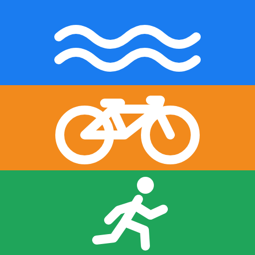
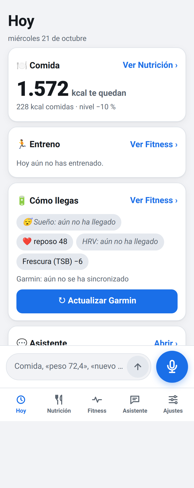
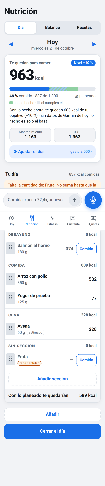
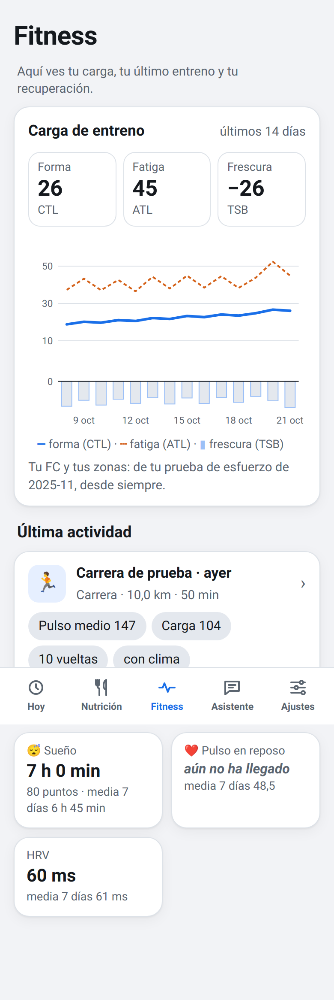
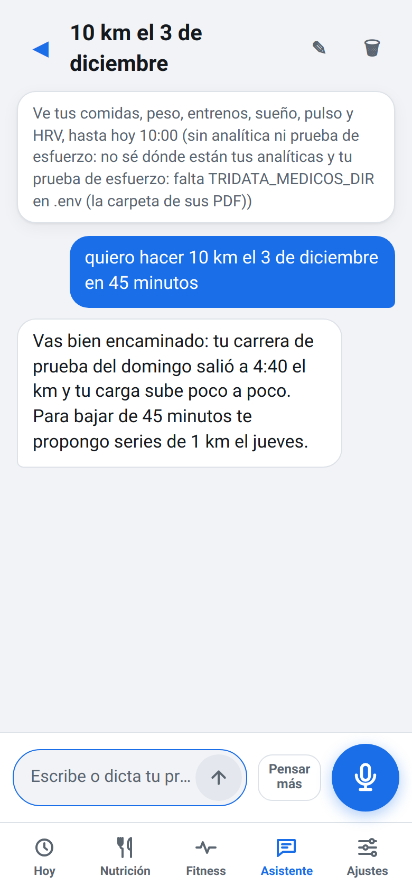

<p align="center">
  
</p>

<h1 align="center">TriData</h1>

**A personal, local-first training and nutrition app for one triathlete — with an AI coach that sees the whole picture.**

TriData started as a script that pulled Garmin Connect data into a file you could paste into Claude. It has grown
into a phone app that runs on your own PC: it tracks what you eat, how you train, how you sleep and recover, and
puts an AI assistant on top of *all of it at once*.

<p align="center">
  
  
  
  
</p>
<p align="center"><sub>Screenshots from the end-to-end tests, with invented data. The interface is in Spanish.</sub></p>

## The step forward: an AI coach with full context

Most training apps see one slice of you: the watch sees your runs, the food app sees your meals, the lab report
sits in a drawer. A coach that only sees one slice can only give generic advice.

TriData's assistant sees **everything, together**:

- **Training** — every Garmin activity with laps and weather, training load (CTL / ATL / TSB), heart-rate zones.
- **Recovery** — sleep, HRV, resting heart rate.
- **Nutrition** — every meal logged, the daily kcal budget, weight trend and the deficit over time.
- **Health** — your blood tests and stress-test reports, read from their PDFs on your own disk.

That changes the conversation. You can *negotiate* a training plan instead of receiving one — «I want to run
10 km under 45 minutes on December 3rd, but this week I slept badly and I'm eating in a deficit» — and you can
discuss health questions with something that has actually read your numbers.

It is only a seed. Today the metrics are those of a consumer watch and a yearly blood test, and the models are
the ones we can afford to call. As sensors get more precise and models get more capable, this is what a personal
coach will look like: one that knows your body as a whole, remembers all of it, and reasons about it with you.

## What it does today

| Tab | What you get |
|---|---|
| **Hoy** (Today) | One screen: kcal left for the day, today's training, how you arrive (sleep, HRV, resting HR, freshness) and the last assistant answer. |
| **Nutrición** | The day's kcal budget from your basal expenditure, your Garmin steps and a chosen deficit level; meals in sections with drag and drop; a balance and weight chart between any two dates; recipes with versions and pot tares; 80+ common foods preloaded. |
| **Fitness** | Training load of the last 14 days, the last activity with laps and weather, sleep, HRV and resting HR against their 7-day averages. |
| **Asistente** | Conversations with Claude over your whole context. It can propose changes (a food, a recipe, a day's plan) as cards you confirm or discard: nothing is written without you. Shows what the month has cost. |
| **Ajustes** | Basal kcal, kcal per step, deficit level, HR max / rest and zones (with their origin: a stress test or a setting). |

And everywhere:

- **Write or dictate** «arroz con pollo 350 g, yogur, peso 72,4» and it is understood and turned into entries to
  review. Dictation runs **locally on your GPU** (Whisper large-v3-turbo): the audio never leaves the PC.
- **Daily Garmin sync** at 08:00, retrying every hour until 14:00, backing off when Garmin rate-limits; the app warns
  when Garmin is behind and can catch up on demand.
- **Installable on the phone** (it is a web app served by your PC; reach it from outside through Tailscale).
- **MCP server** so Claude Code or Claude Desktop can query the same data, read-only.

## Privacy and cost

- **Everything lives in one SQLite file on your PC** (`~/.tridata/data.sqlite3`), with verified backups before
  every sync. No cloud of ours, no account, no telemetry.
- **The only thing that leaves the PC** is what you ask the assistant, sent to the Anthropic API with the context
  it needs. Garmin credentials stay in a local `.env` and only talk to Garmin.
- **A monthly spending cap** (5 $ by default): every API call is priced and recorded — including the ones that fail
  half-way — and at the cap the assistant stops until the 1st. The daily use costs cents.
- **Health data never reaches this repository.** Tests and fixtures are invented, and
  `tridata comprobar-privados` checks the code, the git history and the logs for the values of your own medical
  documents, printing only counts.

## Install

Python 3.10 or 3.11.

```bash
git clone https://github.com/andres-bejarano/tridata.git
cd tridata
python3 -m venv .venv && source .venv/bin/activate
pip install -e ".[app]"          # the app; add ,voz for local dictation and ,mcp for the MCP server
cp .env.example .env             # Garmin email/password, Anthropic API key, optional settings
tridata sync --since 2026-01-01  # first backfill from Garmin
tridata web                      # http://127.0.0.1:8765 — this PC only by default
```

| Extra | For |
|---|---|
| `app` | `tridata web`: the Claude API client and the web server. |
| `voz` | Local dictation: faster-whisper on an NVIDIA GPU (~3 GB to download the first time, no system CUDA needed). |
| `mcp` | `tridata-mcp`, the read-only MCP server. |
| `dev` | Tests, linters and the security checks. |
| `e2e` | End-to-end tests of the phone screen in a real Chromium (Playwright). |

Optional settings in `.env`: `TRIDATA_MODELO_ASISTENTE` (only the fallback model of the Asistente: the model of each
role of the team is chosen in the app, Ajustes › El equipo; «Pensar más» uses Sonnet), `TRIDATA_MODELO_VOZ`,
`TRIDATA_MEDICOS_DIR` (the folder with your medical PDFs; they are read there, never copied) and
`TRIDATA_GOOGLE_CLIENTE` (the path of the JSON of your Google OAuth client for Google Calendar, outside any
repository; the token is saved in `~/.tridata/google-token.json`).

## Commands

| Command | Does |
|---|---|
| `tridata web` | Runs the app. |
| `tridata sync` | Pulls what is new from Garmin Connect (`--since` to backfill, `--revalidate-days` to re-check recent days). |
| `tridata backup` | A verified copy of the store in `~/.tridata/backups/`. |
| `tridata export` · `export-metrics` · `export-running` · `export-cycling` · `export-swimming` · `export-gym` · `export-pmc` · `export-nutricion` | Markdown / JSON exports, for reading or for any AI chat. |
| `tridata show-laps` | Per-lap splits of one activity. |
| `tridata importar-deficit` · `importar-recetas` · `importar-detalle` | One-off imports from a previous Markdown food diary, reviewing the dubious lines first. |
| `tridata comprobar-privados` | Counts appearances of your private health values in the repo, its history and the logs (never prints them). |
| `tridata-mcp` | The MCP server: `list_activities`, `get_activity`, `get_daily_metrics`, `get_training_load`, `get_weekly_summary`, `get_records`. |

## Daily sync

`daily_update.sh` runs a backup, `tridata sync`, laps, weather and the exports, logging to `sync.log`. On Linux a
systemd user timer runs it every hour from 08:00 to 14:00 until a sync succeeds (and on the next boot if the PC was
off):

```bash
cp .config/systemd/user/tridata-sync.* ~/.config/systemd/user/
systemctl --user daemon-reload && systemctl --user enable --now tridata-sync.timer
```

Recent days are re-checked on every run (Garmin sometimes finalizes a day's totals late) and a wider 45-day sweep
runs about once a week. `cron` works too, without the catch-up after a missed run.

## Architecture

```
src/tridata/
├── cli.py                # the `tridata` command
├── garmin_client.py      # Garmin Connect: auth and typed fetches
├── sync.py               # incremental sync, retries, revalidation
├── storage.py            # the local SQLite store
├── metrics.py            # TRIMP from heart rate, CTL / ATL / TSB
├── exporters.py          # Markdown / JSON
├── fitness.py · hoy.py   # what the Fitness and Today screens show
├── nutricion/            # food log, kcal budget, balance, weight, recipes, common foods, imports
├── ia/                   # Claude (understanding food entries, conversations) and local Whisper
├── conversaciones/       # assistant conversations, their context, medical documents, spending
├── privados.py           # `comprobar-privados`
├── mcp_server.py         # `tridata-mcp`
└── web/                  # Starlette app and the phone UI (plain HTML, CSS and JS)
```

Training load is Banister TRIMP from heart rate (measured HR max and rest), not power-based TSS.

## Development

```bash
pip install -e ".[dev]"
scripts/check.sh        # ruff + mypy, the full test suite, gitleaks and pip-audit
```

Tests are written before the code, run against a temporary `HOME`, never call paid APIs (Claude is a test double)
and never use real health data. The same checks run on GitHub Actions for every pull request. The phone screens have
their own end-to-end suite (`pip install -e ".[dev,e2e]" && python -m playwright install chromium`, then
`pytest tests/e2e`).

## Roadmap

- [x] Garmin sync and exports for AI chats
- [x] The phone app: food log with dictation, kcal budget, recipes, balance and weight
- [x] Today and Fitness screens: training load, last activity, recovery
- [x] The assistant: conversations over the whole context, medical documents, spending cap
- [ ] **The team**: a coach that keeps a training plan you negotiate with it, sends sessions to the Garmin watch and to
      Google Calendar, follows niggles and injuries, and prepares races on the real course profile
- [ ] **A desktop web version**, to look at and analyse everything in more depth than a phone screen allows
- [ ] Which model for which job (and which provider), so the monthly cost stays sane as the team grows
- [ ] A photo of a plate → an estimate of its kcal

## License

MIT — see [LICENSE](LICENSE).
